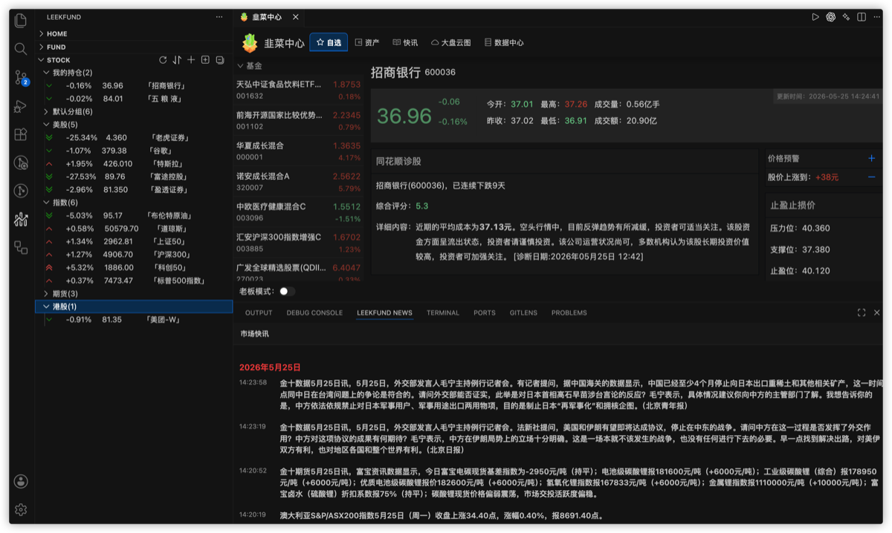
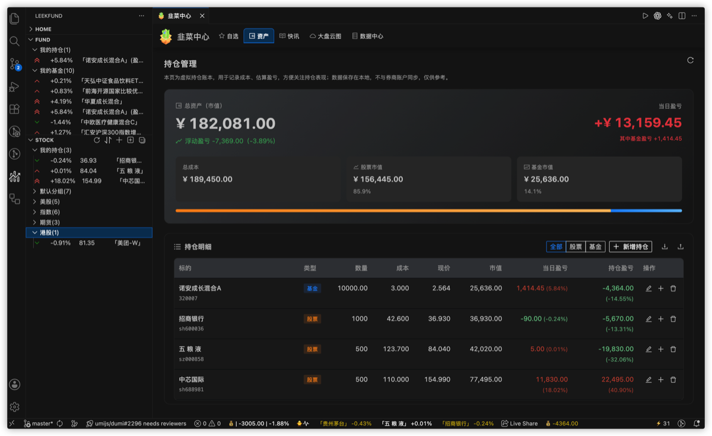
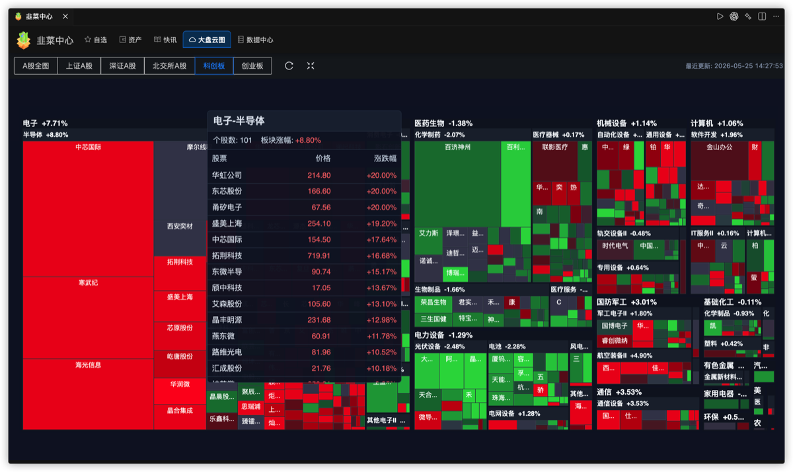
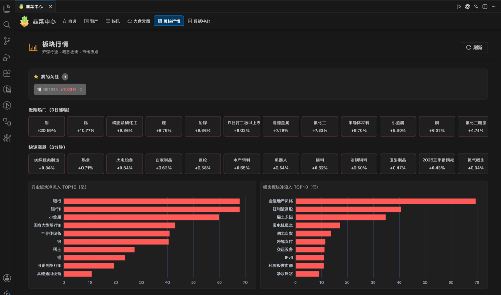
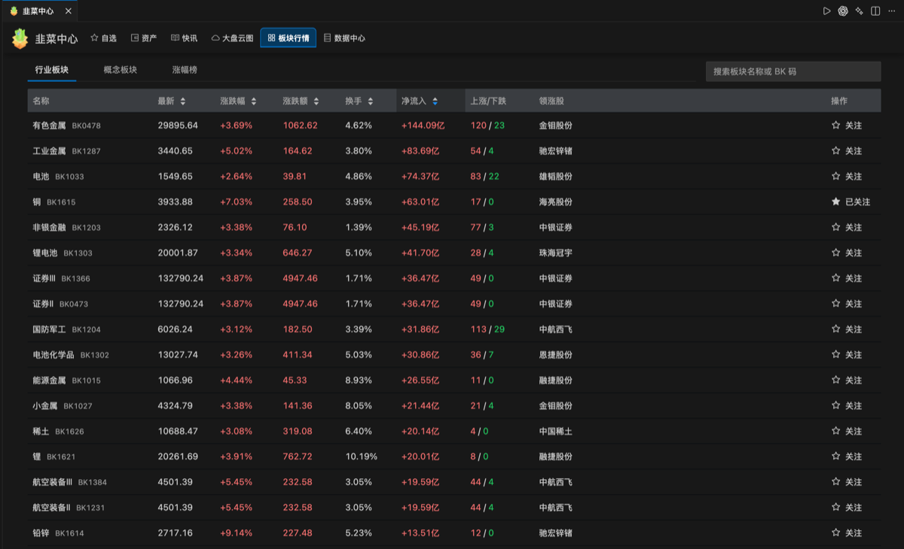
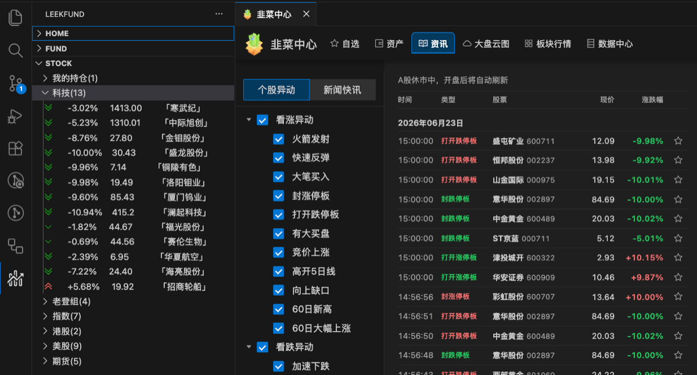
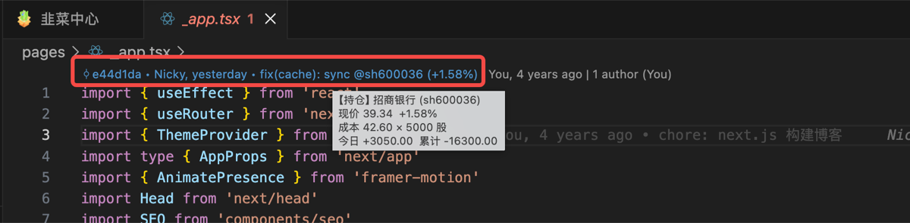
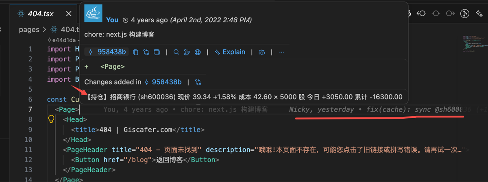

## 本分支更新记录

> 以下为 `quote-pulse`（行情脉冲 QuotePulse）相对上游的改动记录，与原版官方发布无关。

| 日期 | 版本/分支 | 更新内容 |
|------|-----------|----------|
| 2026-11-06 | `dev` | 迁移到独立仓库 `inyuo/quote-pulse`，发布者改为 `inyuo`；品牌更名为「行情脉冲（QuotePulse）」，扩展 id 改为 `quote-pulse`；命令 id 与配置键保持 `leek-fund.*` 不变，老用户配置无需迁移；移除遥测与 `amplitude` / `public-ip` 依赖；**期货模块整体下线**（国内 / 海外期货行情、分类、搜索与相关配置项全部移除） |
| 2026-10-09 | `dev` | 资讯源迁移：由「选股宝」切换为「韭研公社个股新闻」。修复韭研接口鉴权（原 HMACCOUNT/ETag 方案已失效，改为 `md5("Uu0KfOB8iUP69d3c:"+timestamp)` 签名），改为两段式抓取（搜索反查 `stock_id` → 按个股精确拉取），过滤官方置顶帖；移除选股宝快讯推送，快讯输出仅保留金十；数据中心「选股宝快讯」页面改为「韭研公社个股新闻」并支持按股票查询 |
| 2026-08-03 | `dev` | 基金估值数据源由已下线接口迁移至新浪行情接口（GBK 解码 + `Referer`）；快讯服务（金十 / 选股宝）输出与抽象层适配；`leek-center` 前端路由与入口调整；`.gitignore` 补充忽略项；扩展 id 重命名为 `investment-monitor` |

 

> [!NOTE]
> **以下为上游原版 LeekFund 的说明内容**，仅供对照参考，不代表本分支（行情脉冲 QuotePulse）已包含或提供相关功能。原版已商业化运营，请支持原作者。

 

---

# 行情脉冲 QuotePulse

仓库：https://github.com/inyuo/quote-pulse

兼容 VS Code 生态编辑器。在你用 AI 专注于写代码的同时，它在后台实时且隐蔽地追踪着市场，绝不打断你的任何工作流。

投资有风险，入市需谨慎！

> [!IMPORTANT]
> ## 关于本仓库
> 本仓库是从上游 **LeekFund（[LeekHub/leek-fund](https://github.com/LeekHub/leek-fund)）** 派生而来的**个人/独立维护分支**，与官方无任何隶属关系，遵循 BSD-3-Clause 协议。
> - 本仓库的扩展发布名为 **`quote-pulse`**（显示名「行情脉冲 QuotePulse」，发布者 `inyuo`），以避免与官方 Marketplace 上的原版扩展混淆。
> - **原版 LeekFund 已在官方 Visual Studio Marketplace（[giscafer.leek-fund](https://marketplace.visualstudio.com/items?itemName=giscafer.leek-fund)）商业化运营，包含 Pro 付费功能。** 本分支为**非商业、仅自用/学习用途**的衍生版本，**不提供、不修改、不重新分发任何 Pro 付费功能**。
> - 下方「LeekFund Pro」等章节为**原版功能对照说明**，仅用于展示上游能力，**不代表本分支已包含或可用**。如需完整功能与官方支持，请前往官方渠道并支持原作者。
> - 如本分支内容涉及对上游项目的任何不当使用，请随时联系下架。

**声明**：本软件仅为数据辅助展示工具，不提供任何投资建议。数据均来自公开网络渠道，因网络延迟或第三方引起的行情误差，本软件不承担法律责任。

## Table of contents

- [功能特性](#功能特性)
- [安装使用](#安装使用)
- [使用文档](#使用文档)

## 功能特性

### 基础功能

- 基金 / 股票 / Binance 实时涨跌
- 支持 A 股、港股、美股、海外基金、外汇牌价
- 状态栏行情概览
- 基金实时 / 历史走势图、基金排行榜、基金披露持仓信息
- 自定义涨跌颜色与涨跌图标
- 简单版本基金持仓金额、股票成本价维护设置
- 简单版本基金 / 股票盈亏展示
- 股票涨跌提醒配置（IDE 内通知）
- 行情中心：基金 / 股票详情、K 线、资金流向等

### LeekFund Pro

- **股票 / 基金自定义分组**：自定义分组、自动展示「我的持仓」分组、分组折叠、分组、个股拖拽排序
- **持仓管理中心（完整）**：总资产、浮动盈亏、编辑 / 加仓 / 删除、账本导入导出
- **市场快讯**：行情中心>快讯 + LeekFund News 面板
- **大盘云图**：行情中心>大盘云图
- **个性化定制面板**：高级自定义。状态栏股票自选、显示格式、股票收益格式等可视化配置
- **股价预警 Webhook 群推送**（企业微信 / 钉钉 / 飞书）
- **板块行情**：行业 / 概念列表、资金流向、涨幅榜与成分股详情，与大盘云图、自选联动。 [详细文档](https://leek.fund/docs/sector-boards)
- **行情中继**：Pro 用户可在自建服务器部署代理，将股票 / 基金行情请求转至个人中继，应对内网拦截证券 API 或高频监测； [详细文档](https://leek.fund/docs/market-data-relay)
- **LeekAgent**：进行快讯摘要、自选 / 持仓概览、标的公开信息解读。 [详细文档](https://leek.fund/docs/leek-agent)
- **编辑器 Blame 伪装**：在代码文件中以 Git 提交日志样式私密查看持仓股票行情

## 安装使用

安装插件：[Visual Studio Marketplace](https://marketplace.visualstudio.com/items?itemName=inyuo.quote-pulse)

| 要求 | 版本 |
|------|------|
| VS Code | `^1.100.0` |
| Cursor | `^3.0.0` |

## 使用文档

- [在线功能介绍](https://leek.fund/docs/getting-started)
- [行情中继（Pro）](https://leek.fund/docs/market-data-relay)

<!-- https://raw.staticdn.net/ 为GitHub raw 加速地址 -->

### 资产管理

### 大盘云图

### 板块行情

### 个股异动

### Blame 伪装
编辑器 Blame 伪装，相比状态栏与侧边栏查看行情信息更加隐蔽

> 文件头部

> 文件git message。持仓多只股时，鼠标光标依次换行点击即可轮播查看不同持仓股

## 致谢与授权

本项目基于上游 [LeekHub/leek-fund](https://github.com/LeekHub/leek-fund) 及其贡献者的工作派生而来，遵循 **BSD-3-Clause** 协议，上游版权声明与免责声明完整保留在 [LICENSE](./LICENSE) 与源码版权头中。

## License

[LICENSE](./LICENSE)

